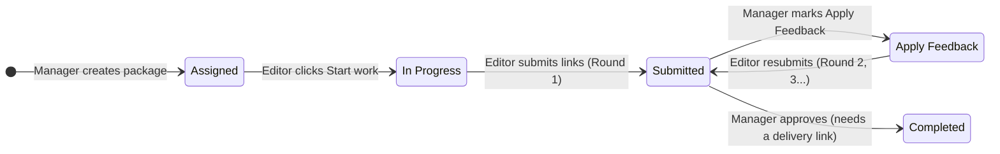
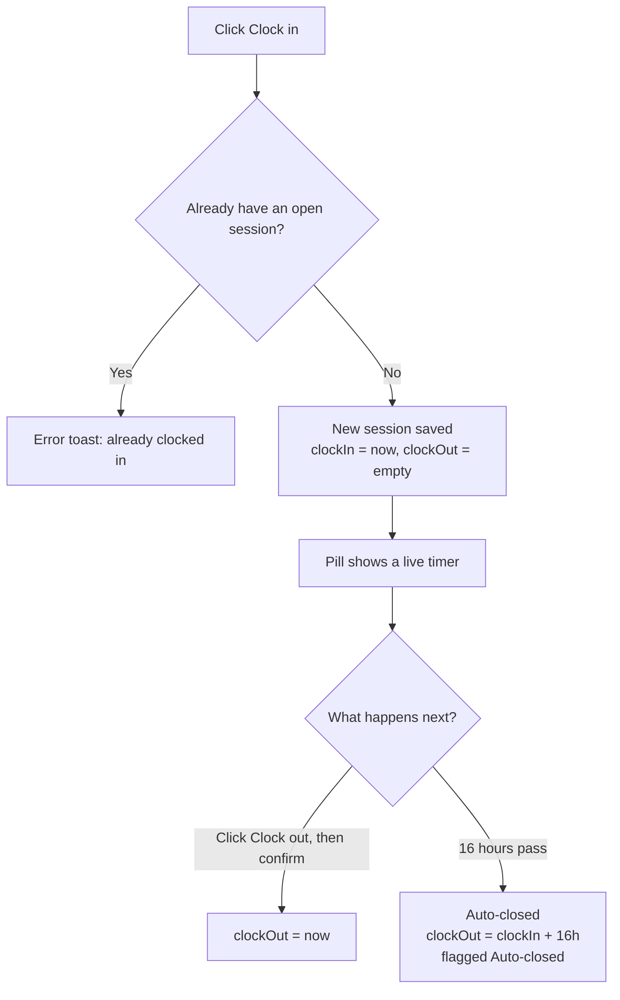
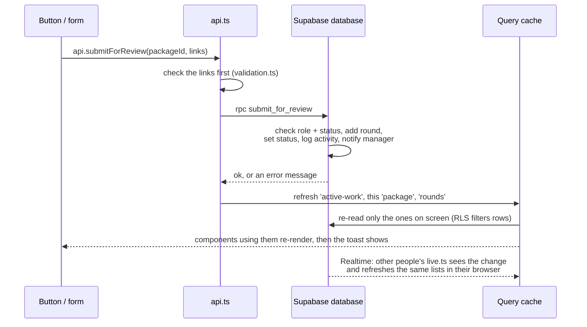
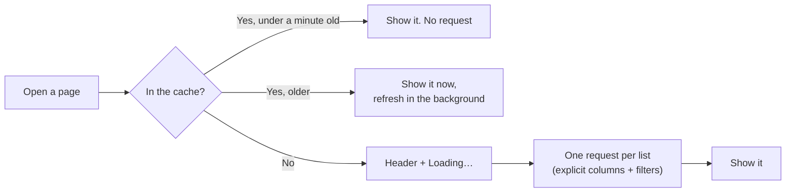

# How the CnE app works (right now)

This guide describes the code as it is today, not as the PRD plans it. Where the two differ, it says so.

> **Short version:** CnE is a React app backed by **Supabase**. You sign in with email and password. The database decides what each person can see (Row Level Security) and runs every change through checked database functions. Each page asks the database only for what it shows, and keeps a copy for a minute so going back to a page is instant. This is **v1** (feature-frozen 2026-10-22). On `cne-dev`, eight of the nine migrations are applied and the Add user function is deployed; the ninth (`20261022100000_account_flags_and_clock_in.sql`) is written and tested but **not applied yet** (see §5). The offline `localStorage` demo was removed on 2026-10-21.

---

## 1. Overview

CnE helps a video editing agency track work. A **package** is one piece of work (for example, "30s hero spot") that belongs to a **product** (for example, "Kapeng Barako Social Shorts"), and is assigned to one **editor**.

The app has five parts. Screens never talk to Supabase directly:

| Part | What it does | Where |
|---|---|---|
| **Screens** (React components) | Show data and react to clicks | `src/pages/`, `src/components/`, `src/layout/` |
| **Session** | Who is signed in, and whether they're approved staff | `src/session/AuthProvider.tsx` |
| **Reading data** | One small hook per list a page shows (`useActiveWork`, `usePackage`, `useNotifications`, …) | `src/data/queries.ts` |
| **Changing data** | One function per action (`api.submitForReview`, `api.clockIn`, …) | `src/data/api.ts` |
| **Live updates** | Listens for other people's changes and refreshes just the affected lists | `src/data/live.ts` |
| **Backend** | Supabase: tables, Row Level Security, workflow functions | `supabase/migrations/` |

**Each page loads what it shows.** The manager dashboard asks for the current (unfinished) packages and the names of people and products. A package page asks for that one package, its rounds, and its activity, in a single request. Long lists (finished packages, notifications, account history, rounds) come 25 or so at a time with a **Show more** button, and the total shown ("Showing 25 of 2,910") is counted by the database, so it's always the real number.

**A cache remembers the answers.** The reads use **TanStack Query** (`@tanstack/react-query`). It stores each answer under a name called a *query key*, for example `['active-work']` or `['package', '…id…']`. If two parts of the screen need the same list (the dashboard and the nav badges both use current work), they share one request. A list is reused for a minute without asking again; after that it's shown from memory right away and refreshed in the background. Coming back to the browser tab also refreshes. The cache is emptied when someone signs out or a different person signs in.

**Signing in:** the app shows a sign-in page (email + password, no sign-up). A new account can't see anything until an admin approves it and gives it a role. Admins see everyone's work **read-only** (an "Overview" and a page per manager and editor) and change only account access.

> 💡 **Learning tip:** open DevTools → *Network* and filter by `rest/v1`. Each click that changes data is one `POST /rest/v1/rpc/<function>` call, followed by one or two small `GET`s for just the lists on your screen. Live updates arrive over a WebSocket (filter by `realtime`).

---

## 2. Diagrams

### 2a. Package workflow (assign → work → submit → review → resubmit)



Each arrow is one database function (`create_package`, `start_work`, `submit_for_review`, `request_feedback`, `approve_package`). Each one also writes an **activity** entry and (usually) a **notification**. The rules live only in the database; the browser checks form input first so it can show errors under each field.

### 2b. Clocking in and out



- Refreshing or closing the tab doesn't clock you out, because the session is saved in the database (`attendance_sessions`).
- The database allows only one open session per person (a unique index), so even two tabs clicking at once can't create two.
- The 16-hour check (`close_stale_sessions`) runs before every clock action, when the app loads, and every 60 seconds while it's open.
- A session that crosses midnight is shown under its **clock-in date** with an **Overnight** tag.

### 2c. How a click changes data and updates the screen



The key idea: **components never change data directly.** They call `api`, and `api` tells the cache which lists the change can affect. Lists on screen are fetched again; lists you aren't looking at are only marked out of date and reload the next time they're shown. Other signed-in people see the change through **Realtime**.

### 2d. Opening a page



Pages other than the three home pages (Dashboard, My Work, Overview) are separate JavaScript files, downloaded the first time you open them. The sidebar stays on screen while one downloads.

---

## 3. Features → source files

### Data layer and backend

| File | Responsibility |
|---|---|
| [`src/data/types.ts`](../src/data/types.ts) | The shape of every piece of data: a package summary for lists, full package details, rounds, sessions, notifications, staff accounts, and pages of a paged list. |
| [`src/data/queries.ts`](../src/data/queries.ts) | Every read: one hook per list, each selecting only the columns it needs with explicit filters, plus the query keys and `pageStatus` (loading/error for a page). |
| [`src/data/api.ts`](../src/data/api.ts) | Every change: checks form input, runs the database function (or the Add user Edge Function), then refreshes only the lists that change can affect. |
| [`src/data/live.ts`](../src/data/live.ts) | Realtime: listens to activity, attendance, and your notifications, and refreshes only the affected lists, merging bursts of events into one refresh. |
| [`src/data/queryClient.ts`](../src/data/queryClient.ts) | The cache and its defaults: fresh for a minute, one retry, refresh when you come back to the tab. |
| [`src/data/hooks.ts`](../src/data/hooks.ts) | Small helpers: `useNow` (a ticking clock), `useDebouncedValue` (waits for typing to stop before searching), `useIsWide` (table on wide screens, cards on narrow). |
| [`src/data/validation.ts`](../src/data/validation.ts) | Checks form input (required fields, valid `https://` links, future deadline, Add user fields) before anything is sent. The database checks it all again. |
| [`src/data/selectors.ts`](../src/data/selectors.ts) | Plain helpers that compute things from loaded lists: "overdue", review-queue order, workload per editor, filters, the approval rule, session durations. |
| [`src/lib/supabase.ts`](../src/lib/supabase.ts) | Creates the Supabase browser client from `.env.local` (publishable key only). |
| [`supabase/migrations/`](../supabase/migrations/) | The database: tables, Row Level Security policies, workflow functions, Realtime, and two read-speed fixes (`…150000_query_performance.sql`). |
| [`supabase/sql-tests/`](../supabase/sql-tests/) | About 125 checks that each role can only read and do what it should, and `volume-fixture.sql`: a year of made-up data (3,000 packages) for speed tests on a scratch database. |

### Sign-in and session

| File | Responsibility |
|---|---|
| [`src/session/AuthProvider.tsx`](../src/session/AuthProvider.tsx) | Restores the saved session, shows Login when signed out, loads the profile, and blocks accounts that aren't approved or are deactivated. As soon as a session is found it starts the first data reads, while the profile is still being checked. |
| [`src/SignedInApp.tsx`](../src/SignedInApp.tsx) | Everything after sign-in: provides the cache, starts live updates, and runs the router. It empties the cache when the person changes or signs out. |
| [`src/pages/auth/Login.tsx`](../src/pages/auth/Login.tsx) | The email + password form (no sign-up link). |
| [`src/pages/auth/AuthLayout.tsx`](../src/pages/auth/AuthLayout.tsx) | The centered card used by sign-in, "Waiting for access", and loading/error screens. |
| [`src/session/context.ts`](../src/session/context.ts) | `useSession()` returns the current person (`me`), `signOut`, and `changePassword` to any component. |
| [`src/pages/admin/Staff.tsx`](../src/pages/admin/Staff.tsx) | Staff & Roles: every account, its role and access, **Approve… / Manage access** buttons, and the account history (paged). |
| [`src/components/domain/StaffAccessDialog.tsx`](../src/components/domain/StaffAccessDialog.tsx) | The approve / change role / deactivate / reactivate dialog. Calls `api.approveAccount` etc.; each change is recorded under the admin. |
| [`src/components/domain/AddUserDialog.tsx`](../src/components/domain/AddUserDialog.tsx) | **Add user**: name, email, title, role, temporary password (with Generate), then a one-time screen to copy the details. Calls `api.createStaffAccount`. |
| [`supabase/functions/create-staff-account/index.ts`](../supabase/functions/create-staff-account/index.ts) | The server-side Edge Function behind Add user: checks the caller is an admin, creates the confirmed account with the service role (no email), then grants the role with `approve_account` as that admin. |
| [`src/pages/auth/SetPassword.tsx`](../src/pages/auth/SetPassword.tsx) | "Choose your password": shown after the first sign-in with a temporary password, before anything else. |
| [`src/pages/Account.tsx`](../src/pages/Account.tsx), [`PasswordForm.tsx`](../src/components/domain/PasswordForm.tsx) | **Your account**: profile and Change password (checks the current password first). |

### Features

| Feature | Files | Responsibility |
|---|---|---|
| **App shell and navigation** | [`src/App.tsx`](../src/App.tsx) | Shows a setup message if Supabase isn't configured, otherwise sign-in, then the signed-in app. |
| | [`src/routes.tsx`](../src/routes.tsx) | Lists every URL and which page it shows. Pages other than the three home pages are downloaded when first opened. |
| | [`src/layout/AppShell.tsx`](../src/layout/AppShell.tsx) | Sidebar, top bar (clock pill, bell, sign out), mobile tab bar with a "More" menu, badge counts (from current work and an unread count), and the once-a-minute attendance sweep. |
| | [`src/layout/nav.ts`](../src/layout/nav.ts) | Menu items and home page for each role. |
| | [`src/pages/RoleGuard.tsx`](../src/pages/RoleGuard.tsx) | Shows a "this page is for managers/editors" message when the wrong role opens a page. A convenience: the database enforces the real rules. |
| | [`src/components/ui/PageStatus.tsx`](../src/components/ui/PageStatus.tsx) | The "Loading…" and "Couldn't load this / Try again" placeholder every page uses, and the **Show more** bar for paged lists. |
| **Create / edit packages** | [`src/pages/manager/PackageForm.tsx`](../src/pages/manager/PackageForm.tsx) | The new/edit package form; loads only the package being edited plus people and products; calls `api.createPackage` or `api.updatePackage`. |
| | [`src/components/domain/AddProductDialog.tsx`](../src/components/domain/AddProductDialog.tsx) | **Add product** (name only), from the Packages page or "New product" in the form; calls `api.createProduct`. |
| | [`src/pages/manager/PackagesList.tsx`](../src/pages/manager/PackagesList.tsx) | All packages with search and filters stored in the URL. |
| | [`src/components/domain/PackageSections.tsx`](../src/components/domain/PackageSections.tsx) | Packages in two parts: current work (complete) and finished work (paged from the server, newest first). Used by Packages and the admin's person pages. |
| **Package detail and review** | [`src/pages/PackageDetail.tsx`](../src/pages/PackageDetail.tsx) | Shows one package and the right action panel for the role (Start, Submit, Approve, Apply Feedback). |
| | [`src/components/domain/SubmissionForm.tsx`](../src/components/domain/SubmissionForm.tsx) | The editor's review/delivery link form. |
| | [`src/components/domain/SubmissionHistory.tsx`](../src/components/domain/SubmissionHistory.tsx) | Lists every submission round, newest first. |
| | [`src/components/domain/ActivityTimeline.tsx`](../src/components/domain/ActivityTimeline.tsx) | Lists the package's activity log. |
| | [`src/components/domain/PackageLifecycleActions.tsx`](../src/components/domain/PackageLifecycleActions.tsx) | The manager's **Manage package** buttons: Hold, Resume, Cancel, Archive, Unarchive, Reopen, and Delete (only while nobody has started it), each with a confirm dialog and, for hold, cancel, and reopen, an optional note. Which buttons show for which status is the `AVAILABLE` table; the database functions enforce the same rules. |
| | [`src/components/domain/ProductsDialog.tsx`](../src/components/domain/ProductsDialog.tsx) | Packages → **Products**: add a product, or edit its name and the client revisions it includes. |
| | [`src/components/domain/ApproveOptions.tsx`](../src/components/domain/ApproveOptions.tsx) | The approve dialog's choice (package page and dashboard quick review): **Send to the client** or **Approve and complete** (needs a delivery link). |
| | [`src/components/domain/ClientReviewActions.tsx`](../src/components/domain/ClientReviewActions.tsx) | While a package is **With Client**: the manager records **Client approved** or **Client wants changes** (with the revision count against the product's allowance); the editor can add a missing delivery link. |
| **Calendar and Reports** | [`src/pages/Calendar.tsx`](../src/pages/Calendar.tsx) | One week of deadlines per editor (`?week=` Monday, `?scope=mine`), busy days and overdue work flagged; a day-by-day list on phones. Reads current work only. |
| | [`src/pages/Reports.tsx`](../src/pages/Reports.tsx), [`src/data/reports.ts`](../src/data/reports.ts) | Delivery and revision numbers for a period, by editor and product. `usePackageReport` loads every package first delivered in the period (with its rounds), and `reports.ts` computes the numbers, so totals cover the whole period. |
| | [`src/components/domain/LinkField.tsx`](../src/components/domain/LinkField.tsx) | A labeled external link with open and copy buttons. |
| **Manager dashboard** | [`src/pages/manager/Dashboard.tsx`](../src/pages/manager/Dashboard.tsx) | 4 clickable tiles, "Needs your review", and "Team workload"; tiles and editor rows open dialogs with details. |
| | [`src/components/domain/ReviewDialog.tsx`](../src/components/domain/ReviewDialog.tsx) | Quick-review dialog: shows the latest round's links and lets a manager approve or mark Apply Feedback without leaving the dashboard. |
| | [`src/components/domain/PackageList.tsx`](../src/components/domain/PackageList.tsx) | Roomy package rows (title, product, editor, status, deadline) used in dialogs and on Deadlines. |
| | [`src/pages/manager/Deadlines.tsx`](../src/pages/manager/Deadlines.tsx) | Overdue, due in 48 hours, and later this week, in three groups. |
| | [`src/pages/manager/ReviewQueue.tsx`](../src/pages/manager/ReviewQueue.tsx) | Full list of submitted packages with an "I'm responsible" filter, yours first, then oldest submission first (`reviewQueue` in `selectors.ts`). |
| **Editor dashboard** | [`src/pages/editor/MyWork.tsx`](../src/pages/editor/MyWork.tsx) | The editor's home: KPIs, needs-changes cards, my packages, recent work, clock card. |
| | [`src/pages/editor/NeedsChanges.tsx`](../src/pages/editor/NeedsChanges.tsx) | Packages marked Apply Feedback, with the manager's note. |
| | [`src/pages/editor/History.tsx`](../src/pages/editor/History.tsx) | The editor's finished packages, 25 at a time. |
| | [`src/components/domain/EditorPackageAction.tsx`](../src/components/domain/EditorPackageAction.tsx) | The Start / Submit / Open button on each row. |
| | [`src/components/domain/FeedbackCard.tsx`](../src/components/domain/FeedbackCard.tsx) | Highlighted card for a package that needs changes. |
| **Attendance** | [`src/components/domain/useClock.ts`](../src/components/domain/useClock.ts) | Clock-in/out logic for the current person, shared by the pill and the card. |
| | [`src/components/domain/ClockControls.tsx`](../src/components/domain/ClockControls.tsx) | The top-bar clock pill, the clock card, and the large `ClockPanel` on Time Clock. |
| | [`src/pages/TimeClock.tsx`](../src/pages/TimeClock.tsx) | Managers' Time Clock tab: big clock, clock in/out, hours today and this week, recent sessions. |
| | [`src/pages/Attendance.tsx`](../src/pages/Attendance.tsx) | Your sessions (last 30 days); managers also see who's clocked in and team attendance (last 14 days). |
| | [`src/components/domain/AttendanceTable.tsx`](../src/components/domain/AttendanceTable.tsx) | Session table with Open, Overnight, and Auto-closed tags. |
| **Notifications** | [`src/pages/Notifications.tsx`](../src/pages/Notifications.tsx) | The notifications page with All/Unread tabs, "Mark all as read", and Show more. |
| | [`src/components/domain/NotificationList.tsx`](../src/components/domain/NotificationList.tsx) | Each notification; clicking marks it read and opens the package. |
| **Admin oversight (read-only)** | [`src/pages/admin/Overview.tsx`](../src/pages/admin/Overview.tsx) | The admin's home: active, overdue, pending reviews, clocked-in count; editor workload, who's clocked in, and each manager's review load. |
| | [`src/pages/admin/Team.tsx`](../src/pages/admin/Team.tsx) | Editors and managers with work counts and clock status (`?role=`, `?access=` in the URL). |
| | [`src/pages/admin/PersonDetail.tsx`](../src/pages/admin/PersonDetail.tsx) | One person's work in tabs: assignments or responsible packages, submissions or review decisions, review queue, attendance, each with URL filters. |
| | [`src/components/domain/ViewOnlyBanner.tsx`](../src/components/domain/ViewOnlyBanner.tsx) | The "View only" note on every oversight screen, so viewing never looks like acting. |
| | [`src/components/domain/SubmissionTable.tsx`](../src/components/domain/SubmissionTable.tsx), [`StaffActivityList.tsx`](../src/components/domain/StaffActivityList.tsx) | Submission rounds across packages; the account history with who made each change. |
| **Shared display pieces** | [`src/components/domain/StatusBadge.tsx`](../src/components/domain/StatusBadge.tsx), [`DeadlineBadge.tsx`](../src/components/domain/DeadlineBadge.tsx), [`PackageTable.tsx`](../src/components/domain/PackageTable.tsx), [`KpiStat.tsx`](../src/components/domain/KpiStat.tsx) | Status (icon + label), deadline countdown, reusable package table, KPI tile. |
| | [`src/components/ui/`](../src/components/ui/) | Generic building blocks: `Dialog`, `ConfirmDialog`, `Field`, `ToastProvider`, `EmptyState`, `Callout`, `Section`, `TabNav` (tabs as links), `FilterSelect`, `PageStatus`. |
| | [`src/lib/time.ts`](../src/lib/time.ts) | Formats every date and time in Asia/Manila (PHT). |
| | [`src/lib/status.ts`](../src/lib/status.ts) | Label, icon, and color for each status. |
| | [`src/lib/back.ts`](../src/lib/back.ts) | "Back" that returns to the page that opened this one: the Packages list passes `backState(...)` on its links, and the package page and package form read it with `useBack(fallback)`, so Back, Cancel, Save, and Delete return to the list with its filters. |
| | [`src/lib/styles.ts`](../src/lib/styles.ts) | Shared Tailwind class recipes for buttons, inputs, and cards. |

---

## 4. Walkthrough: an editor clicks **Submit for review**

Say Bea (editor) is signed in and has a package that's **In Progress**. She pastes a review link and clicks **Submit for review**.

**Step 1: The page and form are shown.**
[`PackageDetail`](../src/pages/PackageDetail.tsx) calls `usePackage(id)`, which reads the package, all its rounds, and its activity in one request. It renders `ActionPanel`; because Bea is an editor and the status is `in_progress` (or `apply_feedback`), that renders `<SubmissionForm>`.

**Step 2: Typing updates local state.**
In [`SubmissionForm.tsx`](../src/components/domain/SubmissionForm.tsx), each input is "controlled": typing calls `setReviewLink` / `setDeliveryLink` (React `useState`). Nothing is saved yet.

**Step 3: The click runs the handler.**
The form's `onSubmit` handler runs:

```ts
event.preventDefault()   // stop the browser from reloading the page
setBusy(true)            // disables the button so it can't be clicked twice
const result = await api.submitForReview(pkg.id, { reviewLink, deliveryLink })
setBusy(false)
```

`await` means "wait for the server to answer". The form has `noValidate`, so the browser's own URL check is off; our checks run instead. Disabling the button is the first guard against a double click; `call()` in `api.ts` is the second: if the same change (same function, same arguments) is already on its way, a repeat waits for that one instead of sending another.

**Step 4: Quick validation in the browser.**
`api.submitForReview` in [`api.ts`](../src/data/api.ts) first calls `validateSubmissionInput` from [`validation.ts`](../src/data/validation.ts):
- Both links empty → "Add a review link, a delivery link, or both."
- A link that isn't a full `http(s)://` URL with a dot in the host (`isHttpUrl`) → "Enter a full link starting with https://"

If that fails, it returns `{ ok: false, error, fieldErrors }` without contacting the server, so the errors appear under the right fields.

**Step 5: The database function runs.**
Otherwise `call('submit_for_review', …)` sends `POST /rest/v1/rpc/submit_for_review` with Bea's session token. In [`20261021100200_workflow_functions.sql`](../supabase/migrations/20261021100200_workflow_functions.sql), `public.submit_for_review`:
1. locks the package row (`private.lock_package`), so two submits can't collide,
2. checks that the caller (`auth.uid()`) is an **active editor** and **the assigned editor** → otherwise "Only the assigned editor can submit this package.",
3. checks the status is `in_progress` or `apply_feedback` → otherwise "Start work before submitting." or "This package isn't waiting for a submission.",
4. checks the links again with `private.is_http_url` (never trust the browser alone),
5. **inserts** a new row in `submissions` with the next round number. Old rounds are never overwritten,
6. sets the package status to `submitted`,
7. writes an `activity` row ("Submitted Round 1 for review") with `private.log_activity`,
8. inserts a `notifications` row for the **responsible manager** with `private.notify` ("Bea Lim submitted Holiday Spot (Round 1)"). It skips people notifying themselves.

All of this happens in **one transaction**: either everything is saved or nothing is. Bea can't do any of these writes directly: the tables are read-only to app users, so this function is the only way in.

**Step 6: Refresh only what changed.**
`api.submitForReview` told `call()` which lists a submission can affect: current work (`['active-work']`), this package (`['package', id]`), and lists of rounds (`['rounds']`). `call()` asks the cache to refresh them (`invalidateQueries`). The ones on screen are fetched again, and Row Level Security still filters the rows, so Bea only gets her own work. Here that's two small `GET`s: the package (for the page) and current work (the nav badges use it). Lists of rounds aren't on Bea's screen, so they're only marked out of date. `call()` waits for those refreshes before it returns, so the screen is already up to date when the toast appears.

**Step 7: Screens re-render.**
Only components that use a refreshed list re-render:
- the package header shows **Submitted**,
- `SubmissionHistory` shows the new round as **Awaiting review**,
- `ActionPanel` swaps the form for "Round 1 is awaiting review".

The nav badges read current work through a `select` that computes just the counts, so the sidebar re-renders only if a number changes.

**Step 8: Feedback for Bea.**
Back in `SubmissionForm.onSubmit`:
- **Failure** (validation or a database error such as "Start work before submitting."): `setErrors(...)` shows the message, and focus moves to the field. A database refusal also refreshes the same lists as a success would, because it usually means the screen was out of date (for example, a manager in another window already acted).
- **Success:** the fields are cleared and `toast.show("Round 1 submitted. Andrea Santos has been notified.")` pops up.

**Step 9: The manager sees it live.**
The manager's browser runs `useLiveUpdates` from [`live.ts`](../src/data/live.ts), subscribed through Realtime to new `activity` rows, `attendance_sessions` changes, and their own `notifications`. Bea's submission wrote one activity row and one notification, so:
- the activity row (by someone else) refreshes current work and that package,
- the notification refreshes the manager's notification list and unread count.

Events that arrive within 200 ms are merged, so this is one refresh per list. The bell count and "Needs your review" update without a page refresh. Bea's own browser skips the activity event for a change it just made itself (it already refreshed in step 6), but her other tabs or devices still refresh.

---

## 5. What's real, what's mock, what's missing

### Connects to a backend (Supabase)

| What | How |
|---|---|
| Sign-in, session restore, sign-out | Supabase Auth, email + password (`AuthProvider.tsx`). The session is kept by supabase-js, so a reload keeps you signed in |
| Who may use the app | `profiles.role` + `profiles.is_active`. New accounts have neither, so they see "Waiting for access" |
| Packages, rounds, activity, attendance, notifications | Postgres tables, read with `select` (only the needed columns, explicit filters, paging) and changed with `rpc` (workflow functions) |
| Permissions | **In the database:** RLS on every table for reads, and role and status checks inside every function for writes. Nobody can change their own role |
| Live updates | Supabase Realtime, which applies RLS. Only the affected lists are refreshed |
| Adding people | **Add user** → Edge Function `create-staff-account` → Supabase Auth admin API (service role, on the server) + `approve_account`. Passwords: `auth.updateUser`, then `complete_password_change()` |
| Admin tasks | In the app (Staff & Roles): `approve_account`, `change_staff_role`, `deactivate_account`, `reactivate_account`, each recorded in `staff_activity` under the admin. The first admin, and admin access in general, only in the SQL editor (`first-admin.sql`, `private.approve_staff`) |
| Admin oversight | RLS read policies give admins every package, round, activity entry, and attendance session; the workflow functions still refuse their writes |

**Current state (2026-10-22):** on `cne-dev` the first eight migrations are applied and the Add user function is deployed. `20261022100000_account_flags_and_clock_in.sql` isn't applied yet: until it is, people added with Add user aren't asked to choose their own password (Supabase Auth writes the "temporary password" flag in a second step that the earlier trigger missed), and a simultaneous second clock-in shows a raw database message ([`supabase-setup.md` step 3](supabase-setup.md#3-apply-the-migrations)). v1 was verified against the **real** Supabase Auth and PostgREST binaries (the versions `cne-dev` runs) on local PostgreSQL, in the API (`supabase/e2e/verify-backend.mjs`) and in a browser; hosted Realtime and the hosted Edge runtime haven't been exercised yet ([`supabase-setup.md` §10](supabase-setup.md#10-verify-the-backend-end-to-end)).

### Signing in, switching people, losing access

| Situation | What happens |
|---|---|
| Reload or reopen the tab | supabase-js restores the session from `localStorage`; you stay on the same page |
| Sign out | The session ends, the live-update channel closes, and the cache is emptied |
| A **different** person signs in on the same browser | They start on their own home page (not the page the previous person left open), with a new router and an empty cache |
| An admin deactivates you, or changes your role, while you're signed in | Every read is refused by RLS at once. When you come back to the tab (or within 5 minutes) the app re-checks your access: deactivated people see "Account deactivated", a new role reloads the app for that role |
| A list fails to refresh in the background (e.g. offline) | What's on screen stays; only a list that never loaded shows "Couldn't load this" with Try again |
| A change is refused ("already approved", "already clocked in") | The error is shown and the affected lists refresh, so the screen catches up |

### Uses mock data / `localStorage`

Nothing in the app. The offline demo (`VITE_USE_DEMO_DATA`, sample data, account switcher) was **removed on 2026-10-21**: it had its own copy of every workflow rule to keep in step with the SQL. The only thing in `localStorage` is the Supabase session token, which supabase-js manages.

For speed tests there's `supabase/sql-tests/volume-fixture.sql`: a year of made-up data (1 admin, 2 managers, 18 editors, 3,000 packages) that only runs on an empty scratch database.

### Not implemented

| PRD item | Status in code |
|---|---|
| Password reset by email ("forgot password") | ❌ Ask the admin, who resets it in the Dashboard. (Adding people works in the app with a temporary password; there are no invite emails.) |
| Google sign-in | ❌ Deferred; a future addition |
| Editing names/titles in the app | ⚠️ Set at Add user; change them later via `private.approve_staff` in the SQL editor |
| Attendance correction requests, approvals, direct corrections, audit history | ⏸ Deferred after v1. The Attendance page tells people to ask their manager |
| Removing products, Editors management screen | ❌ Products can be added and renamed (Packages → Products), not removed. Clients were removed on purpose (2026-10-21) |
| Scheduled 16-hour auto-close | ⚠️ Runs on every clock action and every minute while someone has the app open; `pg_cron` is still a proposal |
| Global search box and user menu in the top bar | ❌ Search exists only on the Packages page filters |
| Email notifications, deadline reminders | ❌ Out of scope for v1 / proposal |

### Where the code differs from (or adds to) the PRD

- **At least one link per submission.** The PRD only says the delivery link is optional. The code also allows a submission with **only** a delivery link and no review link, and rejects a submission with neither.
- **Deadlines must be in the future** when you create a package or change its deadline. The PRD doesn't say this.
- **Any manager can approve** or request feedback, but **only the responsible manager is notified** of a submission. (This matches the permission matrix; just be aware of it.)
- **Reassigned-away editors lose access.** Editors can only read packages currently assigned to them (the packages RLS policy), and History only lists their current packages. So after a reassignment, the previous editor's "reassigned" notification opens a "Package not found, or not assigned to you" screen, and their earlier work disappears from their History. The PRD says rounds are kept (they are, on the package) but doesn't say whether the previous editor keeps visibility.
- **Auto-close isn't scheduled.** The database closes stale sessions whenever anyone clocks in or out, and the app asks it to every minute while open. The PRD's `pg_cron` idea is still a proposal.
- **Reassign is done through Edit,** not a separate Reassign dialog.
- **TanStack Query is in use; shadcn/ui isn't yet.** Both are approved in the PRD. TanStack Query handles reading, caching, paging, and refreshing; dialogs still use the native `<dialog>` element.
- **Long lists are paged.** Finished packages and rounds 25 at a time, notifications 30, account history 20, each with Show more and the database's total. Attendance shows the last 30 days (yours) and 14 days (team).
- **Accounts start in the Supabase Dashboard,** not through invite emails, for now (PRD decision 15).
- **The Review Queue badge counts all submitted packages,** not only yours.

---

## 6. Try it yourself in the browser

You need the migrations applied, the Add user function deployed, and three accounts: you (admin), a test **manager**, and a test **editor** ([`supabase-setup.md` §3–8](supabase-setup.md#3-apply-the-migrations)). Then:

```bash
npm install
npm run dev                       # http://localhost:5173
# or, to try the production build:
npm run build && npm run preview  # http://localhost:4173
```

Use a normal window for one person and a private window (or another browser) for the next. Signed-in sessions are per browser, so two windows of the same browser are the same person. Changes appear live in the other window.

### A. Manager creates and assigns a package

1. Sign in as the **manager** and go to **Packages → New package**.
2. Fill in:
   - **Title:** `My test reel`
   - **Product:** pick one, or click **New product** to add one by name (notice that **Responsible manager** is already you)
   - **Assigned editor:** your test editor
   - **Final deadline:** any time tomorrow
3. Try clicking **Create and assign** with the title empty first: you'll see an inline error. Then fill it in and save.
4. You land on the package page. Status: **Assigned**. The Activity section says "Created and assigned to …".

### B. Editor starts and submits

5. In the private window, sign in as the **editor**. The bell shows a new unread notification.
6. Click the bell, then the "New package assigned: My test reel" message. It's marked read and the package opens.
7. Click **Start work**. Status: **In Progress**.
8. Click **Submit for review** with both fields empty: you see "Add at least one link".
9. Type `hello` in **Review link** and submit: you see "Enter a full link starting with https://".
10. Enter `https://f.io/test-r1` as the review link only and submit. You see a toast, the status becomes **Submitted**, and Submission history shows **Round 1 · Awaiting review**.

### C. Manager requests changes

11. Back in the manager's window (no reload needed): the bell and the **Review Queue** badge both went up.
12. On the **Dashboard**, find the package under "Needs your review" and click **Review**. A dialog opens with the round's links.
13. **Approve** is disabled, with a "Can't approve yet" note: this round has no delivery link.
14. Click **Apply Feedback** (the dialog switches to a note field), type `Shorten the intro`, and click **Send back for changes**. Status: **Apply Feedback**.

### D. Editor resubmits

15. In the editor's window, open **Needs Changes**: your package is there with the note.
16. Click **Open and resubmit**. Enter the **same** review link `https://f.io/test-r1` **plus** a delivery link `https://drive.google.com/test`. Click **Resubmit for review**.
17. Submission history now shows **Round 2** and **Round 1** as separate records. Round 1 shows the feedback note.

### E. Manager approves

18. In the manager's window, click **Review** on the dashboard (or open the package), click **Approve**, then **Approve and complete**.
19. Status: **Completed**. In the editor's window there's an "approved" notification, and the package is in **History**.

### F. Attendance

20. As the **manager**, open **Time Clock** in the sidebar (on a phone: **More → Time Clock**). You see the Manila time, your status, and hours worked today and over the last 7 days. Editors use the clock pill in the top bar or the card on **My Work**.
21. Click **Clock in**. The button and the top-bar pill both switch to clocked in, with a timer. **Refresh the page**: you're still clocked in.
22. Click **Clock out** → confirm. The session appears under "My sessions".
23. Overnight sessions and the 16-hour auto-close need real time to pass; the SQL checks in `supabase/sql-tests/` cover both.

### G. Package lifecycle (managers)

24. Create a package and, without starting it, open it. Under **Manage package** you see **Put on hold**, **Cancel package**, and **Delete package**. Delete it: you land on Packages, and the editor gets a "was deleted" notice with no link.
25. Create another and let the editor start it. **Put on hold** with a reason: the status is **On Hold**, the reason shows above the brief, and the editor's **My Work** lists it under **On hold** (they can't submit). **Resume** returns it to exactly the status it had.
26. Open a **Completed** package. **Reopen for changes** (optional note) moves it to **Apply Feedback**; the editor resubmits as a new round and the approved round stays in the history. **Edit** on a completed package changes details only; the editor and deadline are locked.
27. **Cancel package** (optional reason), then **Archive**. Archived packages have no Edit button; **Unarchive** returns them to Cancelled (or Completed).
28. On **Packages**, click **Products** to add a product or rename one.

### H. Client review, Calendar, Reports (managers)

29. In **Packages → Products**, edit a product and set **Revisions** to `1`.
30. Have an editor submit a package of that product with only a review link. As the manager, click **Approve…**: **Send to the client** is selected, and **Approve and complete** explains it needs a delivery link. Send it. The status is **With Client**; **Client approved** waits for a delivery link.
31. Click **Client wants changes**, type a note: the dialog says "client revision 1 of the 1 included". The package goes back as **Apply Feedback**, and the header shows **Client revisions 1 of 1 included**.
32. As the editor, resubmit, and after the manager sends it to the client again, use **Add delivery link** on the package page. As the manager, click **Client approved**: the package is **Completed**.
33. Open **Calendar**: each editor's deadlines this week, with **Busy day** when an editor has 3 or more due on one day and an **Overdue** column for older work. **Reports** shows the period's deliveries, on-time and first-pass rates, and revisions, including packages over their allowance.

### G. See the role checks

24. As the **editor**, type `http://localhost:5173/dashboard` in the address bar: "This page is for managers".
25. Copy a package URL from the manager's window that belongs to a different editor (or any URL after a reassignment) and open it as the editor: "Package not found, or not assigned to you".

### H. Dashboard drill-downs (manager)

26. On the **Dashboard**, click the **Overdue** tile: a dialog lists the overdue packages. **Open deadlines** goes to the full Deadlines page.
27. Click an editor under **Team workload** to see their active packages in a dialog.
28. Open **Deadlines** in the sidebar and switch between **All packages** and **I'm responsible**.

### I. Admin oversight

29. Sign in as **yourself (admin)**. You land on **Overview**: a blue **View only** note, the four tiles, editor workload, who's clocked in, and each manager's reviews. There's no clock pill.
30. Open **Team** and click your test editor: tabs for **Assignments**, **Submissions**, and **Attendance**, each with filters kept in the URL. Open a package from there: the Actions panel says **View only** and has no buttons.
31. Open **Team → Managers →** your test manager **→ Decisions**: every round they approved or sent back.
32. Open **Staff & Roles**, click **Add user**, fill in a name and email, pick a role, click **Generate a password**, and add them. The next screen shows the details once. Sign in as them in a private window: you're asked to choose your own password first.
33. Click **Manage access** for your test editor and pick **Manager**: it's refused while they have open packages. **Deactivate…** works (with a warning), and **Reactivate** brings them back. Both are recorded in the account history under your name.

### J. See how little each page loads

34. Open DevTools → **Network**, filter by `rest/v1`, and reload the Dashboard: a handful of small requests (people, products, current work, your attendance, the unread count).
35. Open a package: one request brings the package, its rounds, and its activity. Go back to the Dashboard: no new requests, because the lists are less than a minute old.
36. To check speed with **Lighthouse**, test the production build, not the dev server: `npm run build && npm run preview`, then run Lighthouse on `http://localhost:4173`. `npm run dev` serves hundreds of separate, unoptimized files for fast editing, so it always scores low (it measured 41–55 here, versus 96–97 for the build).
