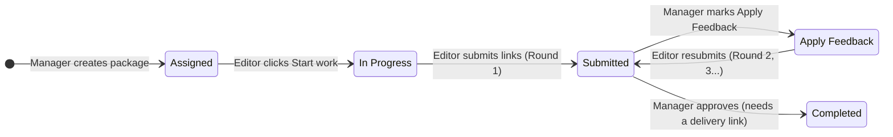
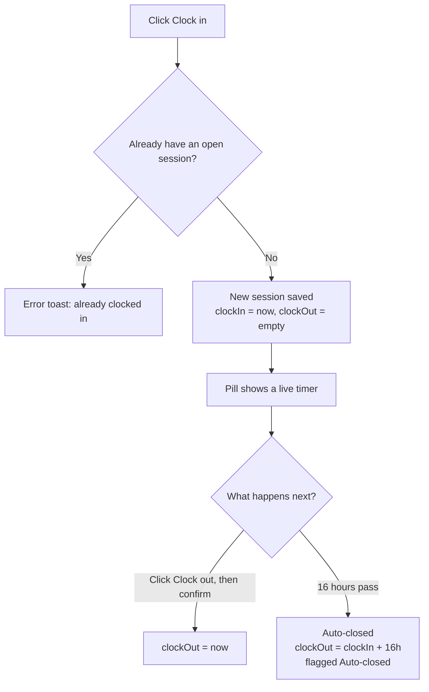
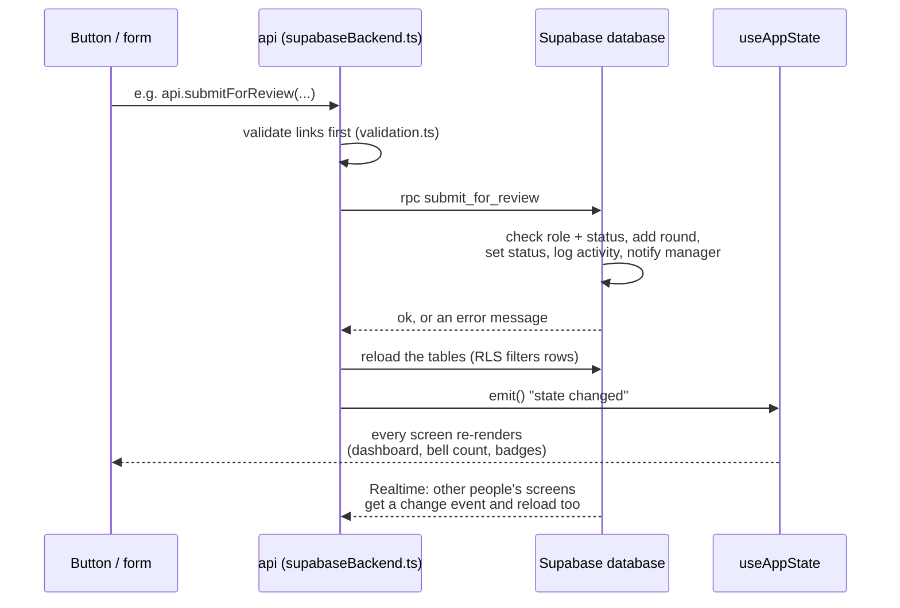

# How the CnE app works (right now)

This guide describes the code as it is today, not as the PRD plans it. Where the two differ, it says so.

> **Short version:** CnE is a React app backed by **Supabase**. You sign in with email and password. The database decides what each person can see (Row Level Security) and runs every change through checked database functions. The Supabase migrations are written and tested locally but **not applied to the remote project yet**. Until they are, use the offline demo (`VITE_USE_DEMO_DATA=true`), which keeps everything in your browser's `localStorage`.

---

## 1. Overview

CnE helps a video editing agency track work. A **package** is one piece of work (for example, "30s hero spot") that belongs to a **client** and a **product**, and is assigned to one **editor**.

The app has four layers. Each one only talks to the layer below it:

| Layer | What it does | Where |
|---|---|---|
| **Screens** (React components) | Show data and react to clicks | `src/pages/`, `src/components/`, `src/layout/` |
| **Session** | Who is signed in, and whether they're approved staff | `src/session/` |
| **Data access** | One way to read (`useAppState`) and one way to write (`api`) | `src/data/hooks.ts`, `src/data/store.ts` |
| **Backend** | Supabase (default) or the localStorage demo | `src/data/supabaseBackend.ts` + `supabase/migrations/`, or `src/data/demoBackend.ts` + `src/data/workflow.ts` |

All the data a person can see is loaded into **one JavaScript object** called `AppState` (defined in `src/data/types.ts`): people, clients, products, packages, submission rounds, activity, attendance sessions, notifications, and (admins only) the account history. With Supabase it's filled from database tables, and the database only returns the rows that person may read. In the demo it's saved to `localStorage` under `cne.demo.state`.

**Signing in:** with Supabase, the app shows a sign-in page (email + password, no sign-up). A new account can't see anything until an admin approves it and gives it a role. Admins see everyone's work **read-only** (an "Overview" and a page per manager and editor) and change only account access. In the demo, a **"Demo account" dropdown** in a yellow bar replaces sign-in; it isn't security.

> 💡 **Learning tip:** open DevTools → *Network* and filter by `rest/v1`. Each click that changes data is one `POST /rest/v1/rpc/<function>` call, followed by `GET` requests that reload the tables. In the demo, look at *Application → Local Storage → `cne.demo.state`* instead.

---

## 2. Diagrams

### 2a. Package workflow (assign → work → submit → review → resubmit)



Each arrow is one database function (`create_package`, `start_work`, `submit_for_review`, `request_feedback`, `approve_package`), with a twin in `src/data/workflow.ts` for the demo. Each one also writes an **activity** entry and (usually) a **notification**.

### 2b. Clocking in and out



- Refreshing or closing the tab doesn't clock you out, because the session is saved in the database (`attendance_sessions`; in the demo, `localStorage`).
- The database allows only one open session per person (a unique index), so even two tabs clicking at once can't create two.
- The 16-hour check (`close_stale_sessions`) runs before every clock action, when the app loads, and every 60 seconds while it's open.
- A session that crosses midnight is shown under its **clock-in date** with an **Overnight** tag.

### 2c. How a click changes data and updates the screen



The key idea: **components never change data directly.** They call `api`, and they re-render because `useAppState` tells React the data changed. Notifications are just another table, so the bell count updates with everything else. Other signed-in people see the change through **Realtime**.

In the demo, `api` comes from `demoBackend.ts` instead: it runs the same rules from `workflow.ts` on a copy of the localStorage state and saves it.

---

## 3. Features → source files

### Data layer and backend

| File | Responsibility |
|---|---|
| [`src/data/types.ts`](../src/data/types.ts) | Defines the shape of every piece of data (package, submission, session, notification, staff account, and so on). |
| [`src/data/store.ts`](../src/data/store.ts) | Picks the backend (Supabase or demo) and exports `api`, the only way the UI changes data. |
| [`src/data/backend.ts`](../src/data/backend.ts) | The contract both backends follow: load, subscribe, and the list of commands. |
| [`src/data/supabaseBackend.ts`](../src/data/supabaseBackend.ts) | Reads the Supabase tables, maps rows into `AppState`, calls the database functions, and reloads on Realtime events. |
| [`src/data/demoBackend.ts`](../src/data/demoBackend.ts) | The offline demo: keeps `AppState` in `localStorage` and runs `workflow.ts`. |
| [`src/data/hooks.ts`](../src/data/hooks.ts) | `useAppState` gives components the data and re-renders them on change; `useStoreStatus` reports loading/errors; `useNow` provides a ticking clock. |
| [`src/data/workflow.ts`](../src/data/workflow.ts) | The business rules for the demo. The same rules exist in SQL for Supabase. |
| [`src/data/validation.ts`](../src/data/validation.ts) | Checks form input (required fields, valid `https://` links, future deadline) before anything is sent. |
| [`src/data/selectors.ts`](../src/data/selectors.ts) | Read-only helpers that compute things like "overdue", workload per editor, filtered lists, and unread counts. |
| [`src/data/seed.ts`](../src/data/seed.ts) | Creates the demo's fictional data by replaying real workflow commands. |
| [`src/lib/supabase.ts`](../src/lib/supabase.ts) | Creates the Supabase browser client from `.env.local` (publishable key only). |
| [`supabase/migrations/`](../supabase/migrations/) | The database: tables, Row Level Security policies, workflow functions, Realtime. |
| [`supabase/sql-tests/`](../supabase/sql-tests/) | About 70 checks that each role can only read and do what it should. |

### Sign-in and session

| File | Responsibility |
|---|---|
| [`src/session/AuthProvider.tsx`](../src/session/AuthProvider.tsx) | Restores the saved session, shows Login when signed out, loads the profile, and blocks accounts that aren't approved or are deactivated. |
| [`src/session/DataGate.tsx`](../src/session/DataGate.tsx) | After sign-in, loads the data and starts Realtime, with loading and "try again" screens. |
| [`src/pages/auth/Login.tsx`](../src/pages/auth/Login.tsx) | The email + password form (no sign-up link). |
| [`src/pages/auth/AuthLayout.tsx`](../src/pages/auth/AuthLayout.tsx) | The centered card used by sign-in, "Waiting for access", and loading/error screens. |
| [`src/session/DemoSessionProvider.tsx`](../src/session/DemoSessionProvider.tsx) | Demo only: remembers which demo account you picked. |
| [`src/session/context.ts`](../src/session/context.ts) | `useSession()` returns the current person (`me`) and `signOut` to any component. |
| [`src/pages/admin/Staff.tsx`](../src/pages/admin/Staff.tsx) | Staff & Roles: every account, its role and access, **Approve… / Manage access** buttons, and the account history. |
| [`src/components/domain/StaffAccessDialog.tsx`](../src/components/domain/StaffAccessDialog.tsx) | The approve / change role / deactivate / reactivate dialog. Calls `api.approveAccount` etc.; each change is recorded under the admin. |
| [`src/components/domain/AddUserDialog.tsx`](../src/components/domain/AddUserDialog.tsx) | **Add user**: name, email, title, role, temporary password (with Generate), then a one-time screen to copy the details. Calls `api.createStaffAccount`. |
| [`supabase/functions/create-staff-account/index.ts`](../supabase/functions/create-staff-account/index.ts) | The server-side Edge Function behind Add user: checks the caller is an admin, creates the confirmed account with the service role (no email), then grants the role with `approve_account` as that admin. |
| [`src/pages/auth/SetPassword.tsx`](../src/pages/auth/SetPassword.tsx) | "Choose your password": shown after the first sign-in with a temporary password, before anything else. |
| [`src/pages/Account.tsx`](../src/pages/Account.tsx), [`PasswordForm.tsx`](../src/components/domain/PasswordForm.tsx) | **Your account**: profile and Change password (checks the current password first). |

### Features

| Feature | Files | Responsibility |
|---|---|---|
| **App shell and navigation** | [`src/App.tsx`](../src/App.tsx) | Chooses Supabase sign-in or the demo, then wraps the app in the toast and router providers. |
| | [`src/routes.tsx`](../src/routes.tsx) | Lists every URL and which page it shows. |
| | [`src/layout/AppShell.tsx`](../src/layout/AppShell.tsx) | Sidebar, top bar (clock pill, bell, sign out), mobile tab bar with a "More" menu, badge counts, and the once-a-minute attendance sweep. |
| | [`src/layout/nav.ts`](../src/layout/nav.ts) | Menu items and home page for each role. |
| | [`src/layout/DemoBar.tsx`](../src/layout/DemoBar.tsx) | Demo only: yellow bar with the demo account switcher and "Reset demo data". |
| | [`src/pages/RoleGuard.tsx`](../src/pages/RoleGuard.tsx) | Shows a "this page is for managers/editors" message when the wrong role opens a page. A convenience: the database enforces the real rules. |
| **Create / edit packages** | [`src/pages/manager/PackageForm.tsx`](../src/pages/manager/PackageForm.tsx) | The new/edit package form; calls `api.createPackage` or `api.updatePackage`. |
| | [`src/pages/manager/PackagesList.tsx`](../src/pages/manager/PackagesList.tsx) | All packages with search and filters stored in the URL. |
| **Package detail and review** | [`src/pages/PackageDetail.tsx`](../src/pages/PackageDetail.tsx) | Shows one package and the right action panel for the role (Start, Submit, Approve, Apply Feedback). |
| | [`src/components/domain/SubmissionForm.tsx`](../src/components/domain/SubmissionForm.tsx) | The editor's review/delivery link form. |
| | [`src/components/domain/SubmissionHistory.tsx`](../src/components/domain/SubmissionHistory.tsx) | Lists every submission round, newest first. |
| | [`src/components/domain/ActivityTimeline.tsx`](../src/components/domain/ActivityTimeline.tsx) | Lists the package's activity log. |
| | [`src/components/domain/LinkField.tsx`](../src/components/domain/LinkField.tsx) | A labeled external link with open and copy buttons. |
| **Manager dashboard** | [`src/pages/manager/Dashboard.tsx`](../src/pages/manager/Dashboard.tsx) | 4 clickable tiles, "Needs your review", and "Team workload"; tiles and editor rows open dialogs with details. |
| | [`src/components/domain/ReviewDialog.tsx`](../src/components/domain/ReviewDialog.tsx) | Quick-review dialog: shows the latest round's links and lets a manager approve or mark Apply Feedback without leaving the dashboard. |
| | [`src/components/domain/PackageList.tsx`](../src/components/domain/PackageList.tsx) | Roomy package rows (title, client, editor, status, deadline) used in dialogs and on Deadlines. |
| | [`src/pages/manager/Deadlines.tsx`](../src/pages/manager/Deadlines.tsx) | Overdue, due in 48 hours, and later this week, in three groups. |
| | [`src/pages/manager/ReviewQueue.tsx`](../src/pages/manager/ReviewQueue.tsx) | Full list of submitted packages with an "I'm responsible" filter. |
| | [`src/pages/manager/reviewQueue.ts`](../src/pages/manager/reviewQueue.ts) | Sorts submitted packages: yours first, then oldest submission first. |
| **Editor dashboard** | [`src/pages/editor/MyWork.tsx`](../src/pages/editor/MyWork.tsx) | The editor's home: KPIs, needs-changes cards, my packages, recent work, clock card. |
| | [`src/pages/editor/NeedsChanges.tsx`](../src/pages/editor/NeedsChanges.tsx) | Packages marked Apply Feedback, with the manager's note. |
| | [`src/pages/editor/History.tsx`](../src/pages/editor/History.tsx) | The editor's finished packages. |
| | [`src/pages/editor/editorData.ts`](../src/pages/editor/editorData.ts) | Filters packages for one editor (active, needs changes, history). |
| | [`src/components/domain/EditorPackageAction.tsx`](../src/components/domain/EditorPackageAction.tsx) | The Start / Submit / Open button on each row. |
| | [`src/components/domain/FeedbackCard.tsx`](../src/components/domain/FeedbackCard.tsx) | Highlighted card for a package that needs changes. |
| **Attendance** | [`src/components/domain/useClock.ts`](../src/components/domain/useClock.ts) | Clock-in/out logic for the current person, shared by the pill and the card. |
| | [`src/components/domain/ClockControls.tsx`](../src/components/domain/ClockControls.tsx) | The top-bar clock pill, the clock card, and the large `ClockPanel` on Time Clock. |
| | [`src/pages/TimeClock.tsx`](../src/pages/TimeClock.tsx) | Managers' Time Clock tab: big clock, clock in/out, hours today and this week, recent sessions. |
| | [`src/pages/Attendance.tsx`](../src/pages/Attendance.tsx) | Attendance records: your sessions; managers also see who's clocked in and team attendance (they clock in on Time Clock). |
| | [`src/components/domain/AttendanceTable.tsx`](../src/components/domain/AttendanceTable.tsx) | Session table with Open, Overnight, and Auto-closed tags. |
| **Notifications** | [`src/pages/Notifications.tsx`](../src/pages/Notifications.tsx) | The notifications page with All/Unread tabs and "Mark all as read". |
| | [`src/components/domain/NotificationList.tsx`](../src/components/domain/NotificationList.tsx) | Each notification; clicking marks it read and opens the package. |
| **Admin oversight (read-only)** | [`src/pages/admin/Overview.tsx`](../src/pages/admin/Overview.tsx) | The admin's home: active, overdue, pending reviews, clocked-in count; editor workload, who's clocked in, and each manager's review load. |
| | [`src/pages/admin/Team.tsx`](../src/pages/admin/Team.tsx) | Editors and managers with work counts and clock status (`?role=`, `?access=` in the URL). |
| | [`src/pages/admin/PersonDetail.tsx`](../src/pages/admin/PersonDetail.tsx) | One person's work in tabs: assignments or responsible packages, submissions or review decisions, review queue, attendance, each with URL filters. |
| | [`src/components/domain/ViewOnlyBanner.tsx`](../src/components/domain/ViewOnlyBanner.tsx) | The "View only" note on every oversight screen, so viewing never looks like acting. |
| | [`src/components/domain/SubmissionTable.tsx`](../src/components/domain/SubmissionTable.tsx), [`StaffActivityList.tsx`](../src/components/domain/StaffActivityList.tsx) | Submission rounds across packages; the account history with who made each change. |
| **Shared display pieces** | [`src/components/domain/StatusBadge.tsx`](../src/components/domain/StatusBadge.tsx), [`DeadlineBadge.tsx`](../src/components/domain/DeadlineBadge.tsx), [`PackageTable.tsx`](../src/components/domain/PackageTable.tsx), [`KpiStat.tsx`](../src/components/domain/KpiStat.tsx) | Status (icon + label), deadline countdown, reusable package table, KPI tile. |
| | [`src/components/ui/`](../src/components/ui/) | Generic building blocks: `Dialog`, `ConfirmDialog`, `Field`, `ToastProvider`, `EmptyState`, `Callout`, `Section`, `TabNav` (tabs as links), `FilterSelect`. |
| | [`src/lib/time.ts`](../src/lib/time.ts) | Formats every date and time in Asia/Manila (PHT). |
| | [`src/lib/status.ts`](../src/lib/status.ts) | Label, icon, and color for each status. |
| | [`src/lib/styles.ts`](../src/lib/styles.ts) | Shared Tailwind class recipes for buttons, inputs, and cards. |

---

## 4. Walkthrough: an editor clicks **Submit for review**

Say Bea (editor) is signed in and has a package that's **In Progress**. She pastes a review link and clicks **Submit for review**.

**Step 1: The form is shown.**
[`PackageDetail`](../src/pages/PackageDetail.tsx) renders `ActionPanel`. Because Bea is an editor and the status is `in_progress` (or `apply_feedback`), it renders `<SubmissionForm>`.

**Step 2: Typing updates local state.**
In [`SubmissionForm.tsx`](../src/components/domain/SubmissionForm.tsx), each input is "controlled": typing calls `setReviewLink` / `setDeliveryLink` (React `useState`). Nothing is saved yet.

**Step 3: The click runs the handler.**
The form's `onSubmit` handler runs:

```ts
event.preventDefault()   // stop the browser from reloading the page
setBusy(true)            // disables the button so it can't be clicked twice
const result = await api.submitForReview(editorId, pkg.id, { reviewLink, deliveryLink })
setBusy(false)
```

`await` means "wait for the server to answer". The form has `noValidate`, so the browser's own URL check is off; our checks run instead.

**Step 4: Quick validation in the browser.**
`api.submitForReview` in [`supabaseBackend.ts`](../src/data/supabaseBackend.ts) first calls `validateSubmissionInput` from [`validation.ts`](../src/data/validation.ts):
- Both links empty → "Add a review link, a delivery link, or both."
- A link that isn't a full `http(s)://` URL with a dot in the host (`isHttpUrl`) → "Enter a full link starting with https://"

If that fails, it returns `{ ok: false, error, fieldErrors }` without contacting the server, so the errors appear under the right fields.

**Step 5: The database function runs.**
Otherwise it calls `rpc('submit_for_review', { p_package_id, p_review_link, p_delivery_link })`, which sends `POST /rest/v1/rpc/submit_for_review` with Bea's session token. In [`20261021100200_workflow_functions.sql`](../supabase/migrations/20261021100200_workflow_functions.sql), `public.submit_for_review`:
1. locks the package row (`private.lock_package`), so two submits can't collide,
2. checks that the caller (`auth.uid()`) is an **active editor** and **the assigned editor** → otherwise "Only the assigned editor can submit this package.",
3. checks the status is `in_progress` or `apply_feedback` → otherwise "Start work before submitting." or "This package isn't waiting for a submission.",
4. checks the links again with `private.is_http_url` (never trust the browser alone),
5. **inserts** a new row in `submissions` with the next round number. Old rounds are never overwritten,
6. sets the package status to `submitted`,
7. writes an `activity` row ("Submitted Round 1 for review") with `private.log_activity`,
8. inserts a `notifications` row for the **responsible manager** with `private.notify` ("Bea Lim submitted Holiday Spot (Round 1)"). It skips people notifying themselves.

All of this happens in **one transaction**: either everything is saved or nothing is. Bea can't do any of these writes directly: the tables are read-only to app users, so this function is the only way in.

**Step 6: Reload and broadcast.**
If the function succeeded, `rpc()` calls `load()`, which `select`s each table again. Row Level Security filters the rows, so Bea only gets her own packages and notifications. The rows are mapped into `AppState` (`toState`), and `emit()` tells every subscriber that the data changed.

**Step 7: Screens re-render.**
[`useAppState`](../src/data/hooks.ts) uses React's `useSyncExternalStore`, so every component using it re-renders:
- the package header shows **Submitted**,
- `SubmissionHistory` shows the new round as **Awaiting review**,
- `ActionPanel` swaps the form for "Round 1 is awaiting review".

**Step 8: Feedback for Bea.**
Back in `SubmissionForm.onSubmit`:
- **Failure** (validation or a database error such as "Start work before submitting."): `setErrors(...)` shows the message, and focus moves to the field.
- **Success:** the fields are cleared and `toast.show("Round 1 submitted. Andrea Santos has been notified.")` pops up.

**Step 9: The manager sees it live.**
The manager's browser is subscribed to Realtime changes on `packages`, `submissions`, `activity`, `attendance_sessions`, and `notifications` (`start()` in `supabaseBackend.ts`). The new rows trigger a change event, the app reloads (`scheduleRefresh`), and their bell count (`unreadCount()`) and "Needs your review" list (`reviewQueue()`) update without a page refresh.

*In the demo,* steps 5 and 6 are replaced by `run()` in `demoBackend.ts`, which applies `submitForReview` from `workflow.ts` to a copy of the localStorage state and saves it.

---

## 5. What's real, what's mock, what's missing

### Connects to a backend (Supabase)

| What | How |
|---|---|
| Sign-in, session restore, sign-out | Supabase Auth, email + password (`AuthProvider.tsx`). The session is kept by supabase-js, so a reload keeps you signed in |
| Who may use the app | `profiles.role` + `profiles.is_active`. New accounts have neither, so they see "Waiting for access" |
| Packages, rounds, activity, attendance, notifications | Postgres tables, read with `select` and changed with `rpc` (workflow functions) |
| Permissions | **In the database:** RLS on every table for reads, and role and status checks inside every function for writes. Nobody can change their own role |
| Live updates | Supabase Realtime, which applies RLS |
| Adding people | **Add user** → Edge Function `create-staff-account` → Supabase Auth admin API (service role, on the server) + `approve_account`. Passwords: `auth.updateUser`, then `complete_password_change()` |
| Admin tasks | In the app (Staff & Roles): `approve_account`, `change_staff_role`, `deactivate_account`, `reactivate_account`, each recorded in `staff_activity` under the admin. The first admin, and admin access in general, only in the SQL editor (`first-admin.sql`, `private.approve_staff`) |
| Admin oversight | RLS read policies give admins every package, round, activity entry, and attendance session; the workflow functions still refuse their writes |

**Current state:** sign-in works against `cne-dev`. The two newest migrations **aren't applied yet** and the Add user function isn't deployed; the app shows "Couldn't load your account" or "Couldn't load your work" until the migrations are ([`supabase-setup.md` steps 3–4](supabase-setup.md#3-apply-the-migrations)). The SQL is tested on PostgreSQL 16, and the whole workflow was run end to end in a browser against real PostgreSQL + PostgREST (with simulated Auth and Realtime).

### Uses mock data / `localStorage`

Only the **offline demo** (`VITE_USE_DEMO_DATA=true` in `.env.local`):

| What | Stored in |
|---|---|
| All demo data | `localStorage["cne.demo.state"]`, created from `seed.ts` on first visit |
| Which demo account you're viewing as | `localStorage["cne.demo.account"]` |

The demo's data exists only in that browser, its "permissions" can be bypassed by switching accounts, and it's for trying the UI only. With Supabase, the only thing in `localStorage` is the Supabase session token, which supabase-js manages.

### Not implemented

| PRD item | Status in code |
|---|---|
| Password reset by email ("forgot password") | ❌ Ask the admin, who resets it in the Dashboard. (Adding people works in the app with a temporary password; there are no invite emails.) |
| Google sign-in | ❌ Deferred; a future addition |
| Editing names/titles in the app | ⚠️ Set at Add user; change them later via `private.approve_staff` in the SQL editor |
| On Hold, Resume, Cancel, Archive, Unarchive | ❌ The statuses exist in the types and the database enum, but nothing moves a package to them |
| Reopen a Completed package | ❌ Completed packages can't be edited |
| Attendance correction requests, approvals, direct corrections, audit history | ❌ The Attendance page shows a "later milestone" note |
| Clients & Products and Editors management screens | ❌ Add clients and products with `supabase/scripts/sample-clients.sql` |
| Scheduled 16-hour auto-close | ⚠️ Runs on every clock action and every minute while someone has the app open; `pg_cron` is still a proposal |
| Global search box and user menu in the top bar | ❌ Search exists only on the Packages page filters |
| Email notifications, deadline reminders | ❌ Out of scope for v1 / proposal |

### Where the code differs from (or adds to) the PRD

- **At least one link per submission.** The PRD only says the delivery link is optional. The code also allows a submission with **only** a delivery link and no review link, and rejects a submission with neither.
- **Deadlines must be in the future** when you create a package or change its deadline. The PRD doesn't say this.
- **Any manager can approve** or request feedback, but **only the responsible manager is notified** of a submission. (This matches the permission matrix; just be aware of it.)
- **Reassigned-away editors lose access.** Editors can only open packages currently assigned to them (`canView` in `selectors.ts`, and the packages RLS policy), and History only lists their current packages. So after a reassignment, the previous editor's "reassigned" notification opens a "This package isn't assigned to you" screen, and their earlier work disappears from their History. The PRD says rounds are kept (they are, on the package) but doesn't say whether the previous editor keeps visibility.
- **Auto-close isn't scheduled.** The database closes stale sessions whenever anyone clocks in or out, and the app asks it to every minute while open. The PRD's `pg_cron` idea is still a proposal.
- **Reassign is done through Edit,** not a separate Reassign dialog.
- **No shadcn/ui or TanStack Query yet.** Dialogs use the native `<dialog>` element, and the small store in `supabaseBackend.ts` handles loading and refreshing. Both stay approved for later.
- **Accounts start in the Supabase Dashboard,** not through invite emails, for now (PRD decision 15).
- **The Review Queue badge counts all submitted packages,** not only yours.

---

## 6. Try it yourself in the browser

**With Supabase:** once the migrations are applied and your test users exist, follow [`supabase-setup.md` §9](supabase-setup.md#9-try-it). Sign in as each person in a separate browser or private window, and changes appear live in the others.

The steps below use the **offline demo**, which needs no setup and lets you switch people from one dropdown.

### Setup

1. Add `VITE_USE_DEMO_DATA=true` to `.env.local`.
2. In a terminal: `npm install`, then `npm run dev`.
3. Open **http://localhost:5173**.
4. Optional, for a clean start: click **Reset demo data** in the yellow bar and confirm.

You start as **Andrea Santos (Manager)**. Switch people with the **Demo account** dropdown in the yellow bar. Remove the line from `.env.local` to go back to Supabase sign-in.

### A. Manager creates and assigns a package

1. As **Andrea Santos**, go to **Packages → New package**.
2. Fill in:
   - **Title:** `My test reel`
   - **Client:** Kapeng Barako Co. → **Product:** Seasonal Campaigns (notice that **Responsible manager** fills in as Andrea automatically)
   - **Assigned editor:** Bea Lim
   - **Final deadline:** any time tomorrow
3. Try clicking **Create and assign** with the title empty first: you'll see an inline error. Then fill it in and save.
4. You land on the package page. Status: **Assigned**. The Activity section says "Created and assigned to Bea Lim".

### B. Editor starts and submits

5. Switch to **Bea Lim (Editor)**. The bell shows a new unread notification.
6. Click the bell, then click the "New package assigned: My test reel" message. It's marked read and the package opens.
7. Click **Start work**. Status: **In Progress**.
8. Click **Submit for review** with both fields empty: you see "Add at least one link".
9. Type `hello` in **Review link** and submit: you see "Enter a full link starting with https://".
10. Enter `https://f.io/test-r1` as the review link only and submit. You see a toast, the status becomes **Submitted**, and Submission history shows **Round 1 · Awaiting review**.

### C. Manager requests changes

11. Switch to **Andrea Santos**. The bell and the **Review Queue** badge both went up.
12. On the **Dashboard**, find the package under "Needs your review" and click **Review**. A dialog opens with the round's links.
13. **Approve** is disabled, with a "Can't approve yet" note: this round has no delivery link.
14. Click **Apply Feedback** (the dialog switches to a note field), type `Shorten the intro`, and click **Send back for changes**. Status: **Apply Feedback**.

### D. Editor resubmits

15. Switch to **Bea Lim**. Open **Needs Changes**: your package is there with Andrea's note.
16. Click **Open and resubmit**. Enter the **same** review link `https://f.io/test-r1` **plus** a delivery link `https://drive.google.com/test`. Click **Resubmit for review**.
17. Submission history now shows **Round 2** and **Round 1** as separate records. Round 1 shows the feedback note.

### E. Manager approves

18. Switch to **Andrea Santos**, click **Review** on the dashboard (or open the package), click **Approve**, then **Approve and complete**.
19. Status: **Completed**. Switch to **Bea Lim**: there's an "approved" notification, and the package is in **History**.

### F. Attendance

20. As **Andrea**, open **Time Clock** in the sidebar (on a phone: **More → Time Clock**). You see the Manila time, your status, and hours worked today and over the last 7 days. (Seed data may already have Andrea, Mika, Jun, or Bea clocked in today.) Editors use the clock pill in the top bar or the card on **My Work**.
21. If it says **Clock in**, click it. The button and the top-bar pill both switch to clocked in, with a timer. **Refresh the page**: you're still clocked in.
22. Click **Clock out** → confirm. The session appears under "My sessions".
23. Switch to **Rina Bautista** → **Attendance**: one session a few days ago is tagged **Auto-closed** (exactly 16h long).
24. Switch to a manager → **Attendance** → **Team attendance** → Person: **Ivan Torres**. His night shifts are tagged **Overnight** and listed under the clock-in date.

### G. See the role checks

25. As **Bea Lim**, type `http://localhost:5173/dashboard` in the address bar: "This page is for managers".
26. As Bea, open a package that belongs to another editor (copy its URL while viewing as a manager): "This package isn't assigned to you".

### H. Dashboard drill-downs (manager)

27. On the **Dashboard**, click the **Overdue** tile: a dialog lists the overdue packages. **Open deadlines** goes to the full Deadlines page.
28. Click an editor under **Team workload** to see their active packages in a dialog.
29. Open **Deadlines** in the sidebar and switch between **All packages** and **I'm responsible**.

### I. Admin oversight

30. Switch to **Lea Navarro (Admin)**. You land on **Overview**: a blue **View only** note, the four tiles, editor workload, who's clocked in, and each manager's reviews. There's no clock pill.
31. Click an editor (for example **Mika Dela Cruz**): tabs for **Assignments**, **Submissions**, and **Attendance**, each with filters kept in the URL. Open a package from there: the Actions panel says **View only** and has no buttons.
32. Open **Team → Managers → Andrea Santos → Decisions**: every round Andrea approved or sent back.
33. Open **Staff & Roles**: **Nico Ramos** is waiting. Click **Approve…**, choose **Editor**, and approve. The account history shows "Approved as Editor, by Lea Navarro".
34. Click **Manage access** for **Mika Dela Cruz** and pick **Manager**: it's refused because Mika still has open packages. **Deactivate…** works (with a warning), and **Reactivate** brings Mika back. Both are recorded under Lea.
35. Click **Add user**, fill in a name and email, pick a role, click **Generate a password**, and add them. The next screen shows the details once. The demo has no sign-in, so the password isn't used here; with Supabase the person signs in with it and is asked to choose their own.

### J. Reset

36. Click **Reset demo data** to restore the original sample data. This only affects your browser.
